# Module 1: Processes and threads

Phases 1 and 2 were about one program doing one thing at a time. A storage server doesn't get to work like that. At any moment it might have Client A reading a 10 GB file, Client B writing a 5 GB file and Client C asking whether a file exists, and it has to deal with all three. This module is about the two things the operating system gives me for that: processes and threads.

All the code is in [`examples/`](examples/). `./run.sh` builds and runs every example. The output is from GCC 11 on an x86-64 Linux machine where `std::thread::hardware_concurrency()` says 8. Addresses, pids and timings change from run to run.

| File | What it shows | Run it |
|---|---|---|
| [`sequential_vs_threads.cpp`](examples/sequential_vs_threads.cpp) | Three requests one after another, then on three threads | [Compiler Explorer](https://godbolt.org/z/61hTfEaGa) |
| [`process_vs_thread.cpp`](examples/process_vs_thread.cpp) | A `fork()`ed child can't change the parent's variable; a thread can | [Compiler Explorer](https://godbolt.org/z/G9v943f31) |
| [`creation_cost.cpp`](examples/creation_cost.cpp) | Creating 1,000 threads vs 1,000 processes | [Compiler Explorer](https://godbolt.org/z/MMv1GoKcq) |
| [`shared_and_private.cpp`](examples/shared_and_private.cpp) | Which addresses threads share and which they don't | [Compiler Explorer](https://godbolt.org/z/bP5qPzYGv) |
| [`concurrency_vs_parallelism.cpp`](examples/concurrency_vs_parallelism.cpp) | Two threads on one core vs on two cores | [Compiler Explorer](https://godbolt.org/z/dbWs6M11a) |

---

## 1. The problem: one request at a time

Say the server can only follow one sequence of instructions. It takes Client A first: open the file, read from disk, send the data. Only when A is completely done does it look at B, and then C.

Most of that time isn't spent computing. It's spent waiting for the disk. While the server waits on A's read, the CPU could be doing B's work, and C's question takes almost no work at all, yet C has to wait behind both.

`sequential_vs_threads.cpp` fakes the three requests with `std::this_thread::sleep_for`, which stands in for waiting on a disk: 300 ms for A, 200 ms for B and 50 ms for C. First I run them one after another, then each on its own thread:

```text
sequential requests
A read    start    0 ms  done  300 ms
B write   start  300 ms  done  500 ms
C exists? start  500 ms  done  550 ms
total: 550 ms
threaded requests
A read    start    0 ms  done  300 ms
B write   start    0 ms  done  200 ms
C exists? start    0 ms  done   50 ms
total: 300 ms
```

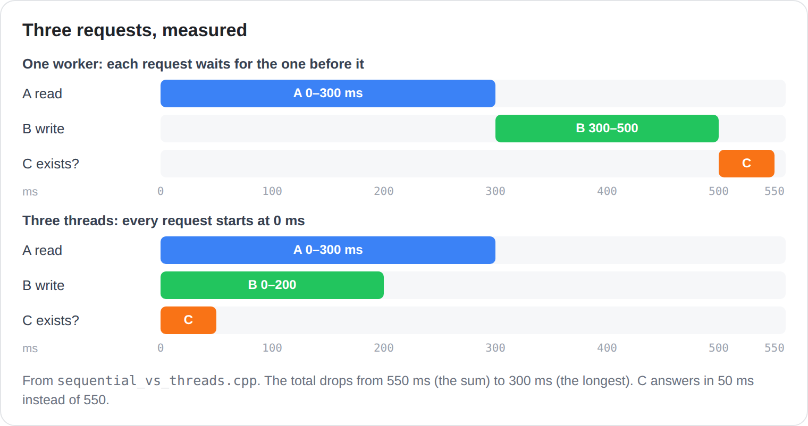

Run in sequence, the total is the sum of the three. With threads, it's the longest one, and C gets its answer after 50 ms instead of 550. Nothing got faster; the requests just stopped waiting for each other. Module 2 goes through `std::thread` itself, so here I only use it to start a function and wait for it with `join()`.

## 2. What a process is

When I run a program on Linux:

```bash
./storage-server
```

the kernel loads it and creates a running instance of it. That running instance is a process. Starting `./prometheus` and `./grafana-server` as well gives me three processes, each one separate from the others.

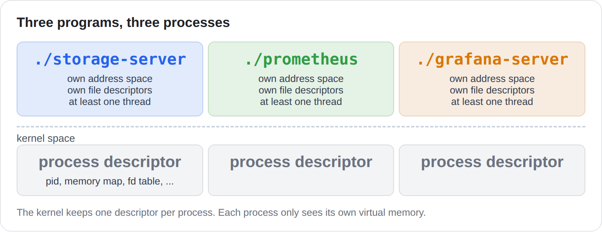

A process is more than the code that's running. It comes with resources the kernel manages for it:

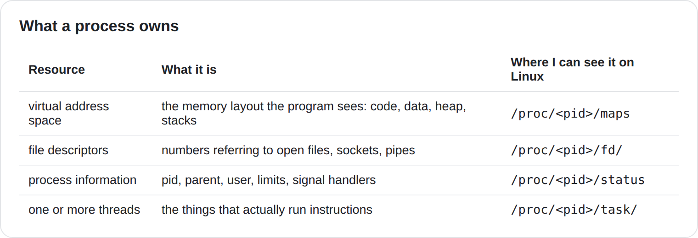

The important one for this phase is the address space. Each process sees its own virtual memory: the code, data, heap and stack layout I went through in [Phase 2, Module 1](https://github.com/IV-cmd/cpp-memory-management/tree/main/01-memory-architecture). One process can't read or write another's memory just by using an address.

## 3. What a thread is

Inside the storage server I don't want one worker doing everything. I want one worker per client, plus maybe one that keeps checking disk health. Those workers are threads. A thread is a path of execution inside a process: it runs the process's code, using the process's memory.

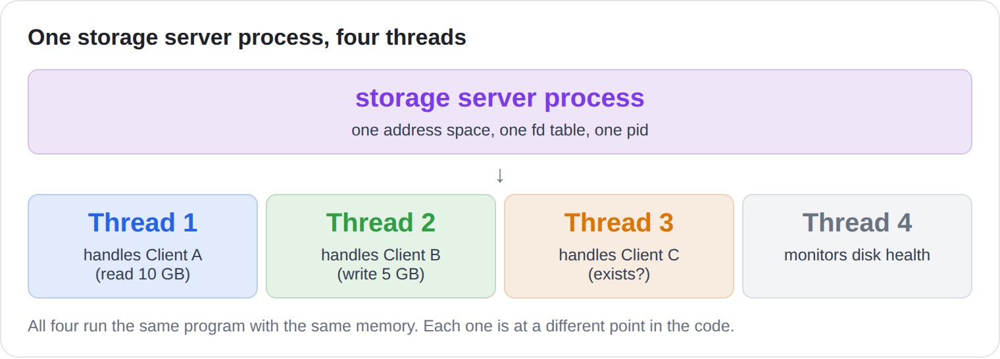

Every process starts with one thread, the one that runs `main()`. It can create more.

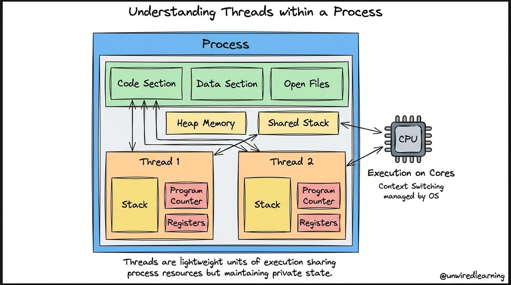

One thing to watch in this sketch: the "Shared Stack" box isn't right. Each thread gets its own stack, and Section 4 shows their real addresses.

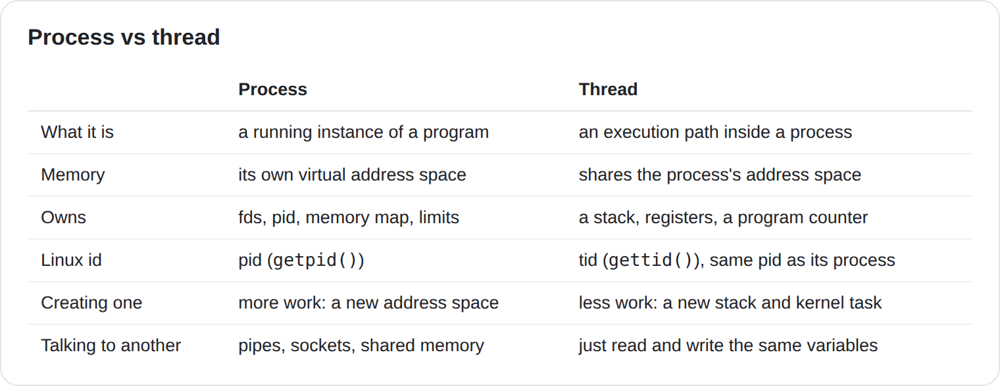

### Seeing the difference

The table says processes have separate memory and threads share it. `process_vs_thread.cpp` checks that with one global, `int counter = 0;`.

First it calls `fork()`, which creates a new process that is a copy of the current one. The child sets `counter = 100` and exits; the parent waits for it and reads `counter`. Then it does the same with a `std::thread`:

```text
forked process
child pid 72884 &counter 0x608c61f62194 value 100
parent pid 72883 &counter 0x608c61f62194 value 0
thread in this process
thread pid 72883 tid 72885
/proc/self/task: 72883 72885
main pid 72883 tid 72883 counter 100
```

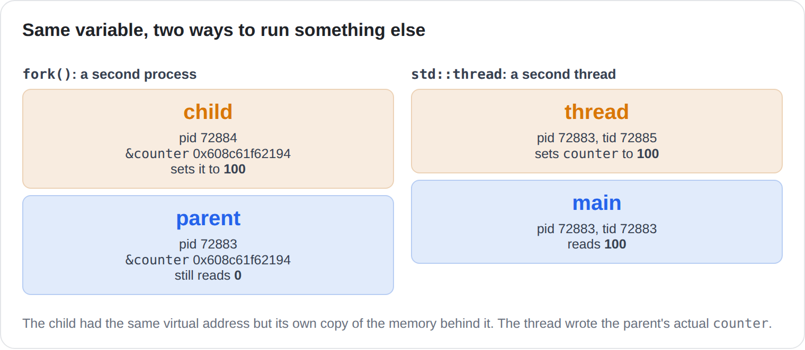

The child printed the same address for `counter` as the parent, and the parent still read 0. They're virtual addresses: the same number means "the same place in my own address space", and the child's address space is a copy. The thread's write, on the other hand, showed up in `main`.

The ids say the same thing. The thread has the same pid as `main` (72883) and its own thread id (72885). While it ran, `/proc/self/task` listed two entries, one per thread. On Linux each thread is a task the kernel schedules, and the process is the group of tasks sharing one address space. The main thread's tid is the pid.

### Which is cheaper to create?

"Threads are cheaper" was the other line in the table, so I measured it. `creation_cost.cpp` starts and waits for 1,000 empty threads, then forks and waits for 1,000 child processes that exit straight away:

```text
N = 1000
threads: 29.81 ms, 29.81 us/thread
processes: 134.65 ms, 134.65 us/process
process/thread ratio: 4.52
```

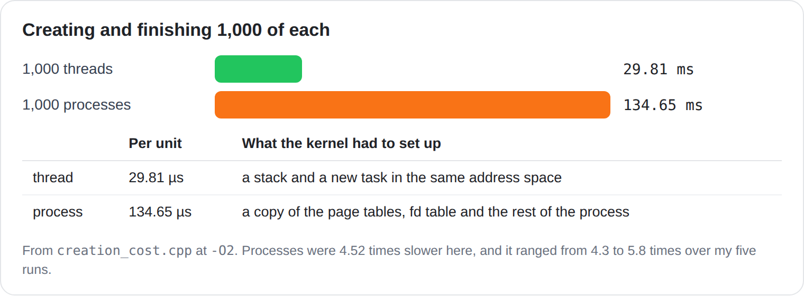

A thread only needs a stack and a new kernel task. A process needs its own copy of the page tables and file descriptor table, even though Linux copies the actual memory pages lazily (copy-on-write). The exact numbers moved around between runs, but processes were always more than four times slower here.

## 4. What threads share and what they don't

Everything later in this phase depends on this part.

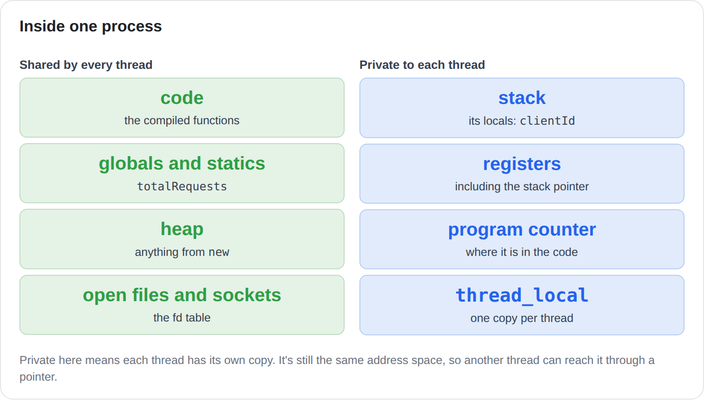

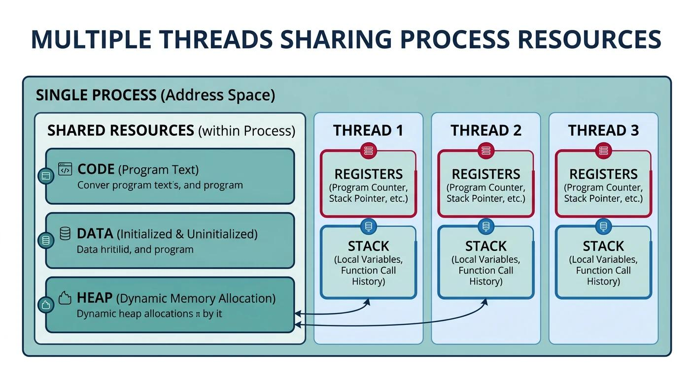

The usual example:

```cpp
int totalRequests = 0;   // global

void handleRequest() {
    int clientId = 10;   // local
}
```

If two threads run `handleRequest()`, there is one `totalRequests` and there are two `clientId`s. The global lives in the process's data segment, and there's only one of those. Each call's local lives in the stack of whichever thread made the call, and each thread has its own stack.

`shared_and_private.cpp` prints the addresses to check. Besides the global and the local, it has a heap object (`int* cache = new int(0)`) and a `thread_local int requestsOnThisThread`. It calls `handleRequest` on the main thread and on two new threads:

```text
main     tid 72874 &totalRequests 0x652a70f23160 cache 0x652a951ddeb0 &clientId 0x7ffc19d83ffc &requestsOnThisThread 0x7b7b596c03bc
thread 1 tid 72875 &totalRequests 0x652a70f23160 cache 0x652a951ddeb0 &clientId 0x7b7b58ffeb8c &requestsOnThisThread 0x7b7b58fff63c
thread 2 tid 72876 &totalRequests 0x652a70f23160 cache 0x652a951ddeb0 &clientId 0x7b7b587fdb8c &requestsOnThisThread 0x7b7b587fe63c
same &totalRequests: yes
same cache: yes
same &clientId: no
same &requestsOnThisThread: no
thread 1 to thread 2 clientId distance: 8196.0 KiB (8.0 MiB)
```

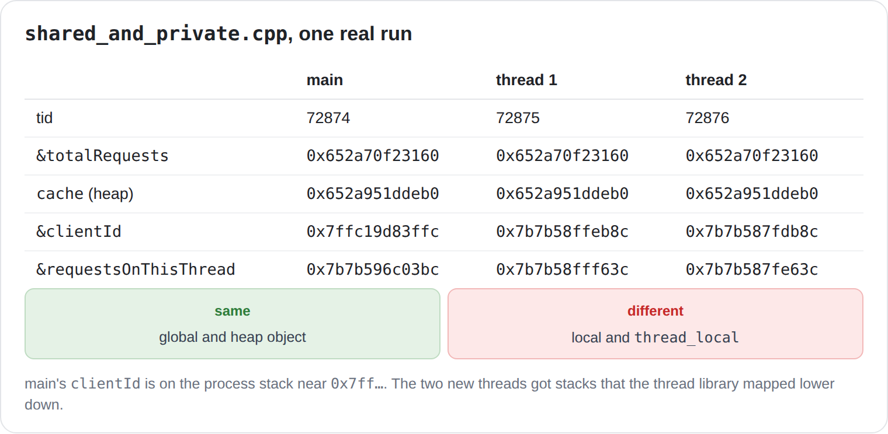

| Variable | Kind | Copies with 3 threads |
|---|---|---|
| `totalRequests` | global | 1 |
| `*cache` | heap object | 1 (every thread has the same pointer) |
| `clientId` | local | 3, one per stack |
| `requestsOnThisThread` | `thread_local` | 3, one per thread |

The `0x7ffc…` address for `main`'s `clientId` is the normal process stack, the one marked `[stack]` in `/proc/self/maps`. The two new threads got stacks that the thread library mapped elsewhere, and they are 8196 KiB apart. That number is 8192 KiB of stack plus 4 KiB:

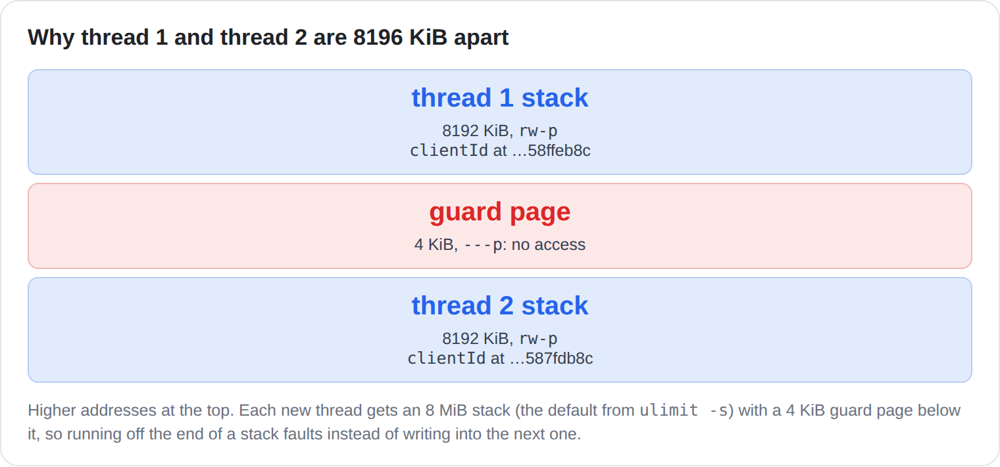

glibc gives each new thread an 8 MiB stack, the same default as `ulimit -s`, and puts a 4 KiB guard page below it that can't be read or written. A thread that overflows its stack hits the guard page and crashes instead of quietly writing into the next thread's stack.

"Private" needs one caveat. A thread's stack is still in the shared address space. If I hand another thread a pointer to my `clientId`, it can read and write it. What threads don't share is the copy each one gets automatically.

## 5. Concurrency vs parallelism

These two words get mixed up a lot, but they mean different things.

- Concurrency: several tasks make progress during overlapping periods of time.
- Parallelism: several tasks execute at the same instant, which needs more than one core.

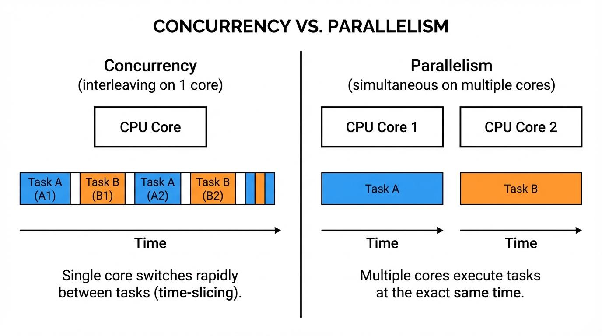

On a single core the kernel switches between threads many times a second. Both threads are in progress, but only one is executing at any instant. That's concurrency without parallelism. With two cores, both threads really run at once.

`concurrency_vs_parallelism.cpp` makes this visible with a CPU-bound `work()` function (a loop of multiplications, with the result printed so the compiler can't drop it). It times one call on its own, then two threads pinned to the same CPU with `pthread_setaffinity_np`, then two threads pinned to different CPUs:

```text
hardware_concurrency: 8
work alone: 259.70 ms (result 7476684235798772801)
two threads on CPU 0 total: 511.60 ms
thread 1 finish 509.00 ms on CPU 0 (result 7476684235798772801)
thread 2 finish 511.47 ms on CPU 0 (result 7476684235798772801)
threads on CPU 0 and CPU 1 total: 252.93 ms
thread 1 finish 252.80 ms on CPU 0 (result 7476684235798772801)
thread 2 finish 252.85 ms on CPU 1 (result 7476684235798772801)
```

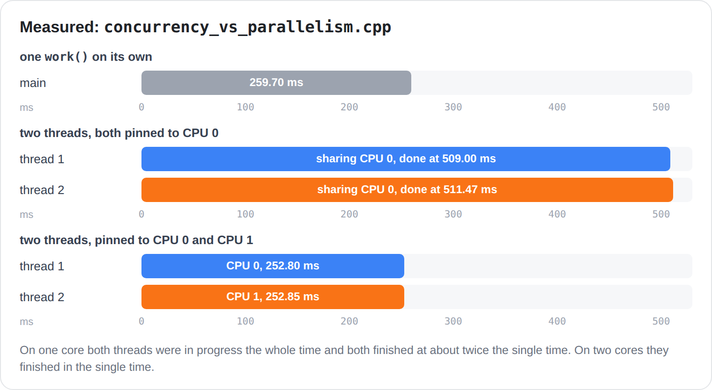

On one CPU, neither thread finished at 260 ms and the other at 520. They finished 2.5 ms apart, both at about twice the single time, so they had been taking turns the whole way through. On two CPUs, the two threads finished in the time one call takes on its own.


The two `sleep_for` threads in section 1 are the other half of this. Waiting doesn't need a core at all, so those three threads would have finished in 300 ms even on one core. Threads help with waiting (I/O) even without parallelism, and they help with computing only when there are cores to run them on.

A note on the Compiler Explorer link for this one: the sandbox reports 2 CPUs and pinning works, but in my runs there the two-CPU case was slower than the one-CPU case (1714 ms vs 1243 ms, with 371 ms alone). The sandbox doesn't seem to give a program two full cores of time, so the parallel speedup only shows up when I run it on my own machine.

## 6. What this means for the storage server

With threads, the server can give each request its own path through the code:

```text
storage server process
├── thread A: read request
├── thread B: write request
├── thread C: metadata request
└── thread D: monitoring
```

A slow disk read in thread A no longer holds up thread C, and on a multi-core machine the threads that do have computing to do can do it in parallel.

The cost is in section 4. All of these threads see the same globals and the same heap. If thread A and thread B both update `totalRequests` at the same time, can one of them overwrite the other's change?

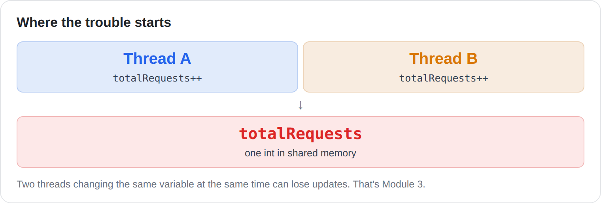

Yes, and that's [Module 3](../03-race-conditions/). Before that, [Module 2](../02-creating-managing-threads/) looks properly at `std::thread`: how to create one, pass it arguments, and what `join()` and `detach()` do.
